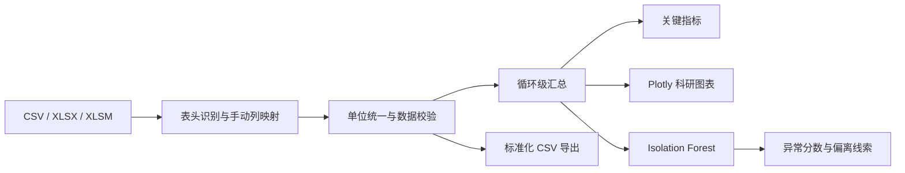

# BatteryAI-Analyzer


**钠离子电池循环数据的可复现分析与探索性异常检测平台**  
**A reproducible analysis and exploratory anomaly-detection platform for sodium-ion battery cycling data**

[中文说明](#中文说明) · [English](#english-version) · [运行方法](#在-macos-上运行) · [Deployment](#streamlit-community-cloud-部署检查)

> 本项目用于科研数据处理与方法演示。示例数据为明确标记的合成数据；异常检测结果是待复核线索，不是电池失效、安全或性能认证结论。
>
> This project is intended for research-data processing and method demonstration. The bundled data is explicitly synthetic; anomaly flags are review cues, not battery-failure, safety, or performance certifications.

---

## 中文说明

### 1. 项目背景

钠离子电池循环测试通常产生大量逐点记录。不同版本的新威（Neware）软件、导出模板和测试规程可能使用不同的列名、单位、电流符号和工步命名。直接依赖固定列名的分析脚本难以复用，也容易在单位或充放电方向上引入静默错误。

BatteryAI-Analyzer 将这类重复工作整理为一条透明、可复现的 Python 分析流程：

1. 读取 CSV 或 Excel 明细数据；
2. 由用户核对并配置列映射、单位和电流符号；
3. 执行数值校验、范围检查和重复记录处理；
4. 计算循环级容量、库伦效率与容量保持率；
5. 绘制循环性能和代表性充放电曲线；
6. 使用 Isolation Forest 提供探索性异常筛查，并显示判定边界与辅助解释。

项目关注的是**分析流程的工程化、可解释性和可复现性**，不替代设备原厂软件、实验记录、质量体系或电化学专业判断。

### 2. 技术框架与 AI/机器学习定位

| 层次 | 技术 | 实际作用 |
| --- | --- | --- |
| 交互界面 | Streamlit | 文件上传、列映射、参数配置、页签化科研仪表板 |
| 数据处理 | Python、Pandas、NumPy | 表格读取、类型转换、清洗、分组聚合和指标计算 |
| 可视化 | Plotly | 交互式循环性能图、电压—容量曲线和异常分数图 |
| 机器学习 | scikit-learn Isolation Forest | 在循环级特征空间中进行无监督、探索性异常筛查 |
| Excel 支持 | openpyxl | 读取 `.xlsx` 和 `.xlsm` 工作簿及工作表 |
| 质量保障 | pytest、Streamlit AppTest、GitHub Actions | 单元测试、界面冒烟测试和持续集成 |

本项目中的“AI”主要体现在两方面：

- **机器学习应用：** 使用 Isolation Forest 识别相对孤立的循环，不使用故障标签，也不宣称监督学习准确率；
- **AI 辅助软件工程：** 在需求拆解、模块设计、代码审查和测试设计中使用 AI 编程工具，最终结果以可运行代码、公开计算口径和自动测试为准。

应用运行时不调用大语言模型或外部 AI API，不需要 API 密钥，也不会自动生成实验结论。

### 3. 已实现功能

- 支持 `.csv`、`.xlsx`、`.xlsm` 文件；
- 兼容 UTF-8、GB18030、GBK CSV 编码和常见导出前置说明行；
- 自动建议中英文列映射，并允许手动修改；
- 映射循环号、工步、时间、电压、电流和容量；
- 配置 mA/A、mAh/Ah、秒/分/小时及电流正负号规则；
- 检查无法解析的数值、非法循环号、越界电压和重复记录；
- 绘制循环充电容量、放电容量和库伦效率；
- 自动绘制第 1、5、10、20、50 圈电压—容量曲线；
- 计算首次库伦效率和指定循环容量保持率；
- 基于五类可用循环特征运行 Isolation Forest；
- 展示异常分数、0 分判定边界、预期异常比例和稳健偏离线索；
- 下载清洗后的标准化 CSV；
- 内置 60 圈合成演示数据和 9 项基础测试。

### 4. 系统流程



核心代码按职责拆分：数据读取位于 `battery_ai/data_loader.py`，校验清洗位于 `battery_ai/validation.py`，指标计算位于 `battery_ai/analysis.py`，异常检测位于 `battery_ai/anomaly.py`，图表位于 `battery_ai/plotting.py`，Streamlit 入口为 `app.py`。

### 5. 科研应用场景

- 新威循环明细数据的快速初检；
- 循环容量衰减和库伦效率趋势的可视化；
- 指定循环的电压—容量曲线对比；
- 数据缺失、符号错误、越界电压和重复记录的质量检查；
- 为后续人工复核定位值得关注的循环；
- 电池数据分析课程、科研编程和机器学习方法演示。

当前版本不支持多电芯批量对比、EIS 分析、寿命预测、故障分类或电池安全诊断。相关功能不能从现有异常检测结果中推断。

### 6. 实际贡献

1. **降低模板耦合：** 通过手动列映射兼容不同导出字段，而不是把分析绑定到单一表头；
2. **明确数据口径：** 单位、符号、清洗规则和计算公式均在界面或文档中公开；
3. **避免缺失圈误导：** 第 1、5、10、20、50 圈不存在时显示为空，不插值、不虚构；
4. **负责任地使用机器学习：** 将 Isolation Forest 定位为探索工具，同时展示参数依赖和方法局限；
5. **提高可复现性：** 固定直接依赖版本，提供确定性示例生成脚本、测试和 CI 配置；
6. **保护实验数据：** 默认忽略原始实验文件、上传目录、密钥、序列化模型和本地产物，仅保留明确标记的合成示例。

### 7. 软件截图

仓库已建立 `screenshots/` 目录，但当前**没有加入任何虚构截图**。请在公开前从真实运行的应用中截取以下页面，并确认图中不包含本地路径、账户信息、实验编号或不可公开数据：

| 建议文件名 | 页面内容 | 当前状态 |
| --- | --- | --- |
| `screenshots/01-overview.png` | 循环性能总览 | 待加入真实截图 |
| `screenshots/02-charge-discharge-curves.png` | 指定圈充放电曲线 | 待加入真实截图 |
| `screenshots/03-anomaly-exploration.png` | Isolation Forest 异常探索 | 待加入真实截图 |
| `screenshots/04-data-quality.png` | 数据校验与清洗报告 | 待加入真实截图 |

截图加入后，可将以下注释替换为实际 Markdown 图片：

```markdown
<!--  -->
```

### 8. 数据格式与计算口径

应用不强制原始列名，但至少需要循环号、电压、电流和容量。工步列缺失时，可根据电流正负号推断充放电；时间列缺失时，使用读取后的记录顺序。

| 规范字段 | 必需 | 常见列名 | 说明 |
| --- | --- | --- | --- |
| 循环号 | 是 | `Cycle ID`、`循环序号` | 转换为正整数 |
| 工步/状态 | 否 | `Step Type`、`工步类型` | 支持 charge/discharge、Chg/DChg、充电/放电关键词 |
| 时间 | 否 | `TestTime(s)`、`总时间` | 支持数值时间或时长文本 |
| 电压 | 是 | `Voltage(V)`、`电压(V)` | 默认有效范围为 0–5 V，可修改 |
| 电流 | 是 | `Current(mA)`、`电流(A)` | 内部统一为 mA |
| 容量 | 是 | `Capacity(mAh)`、`容量(Ah)` | 取绝对值并统一为 mAh |

对每个循环分别取充电和放电阶段的最大累计容量：

```text
Q_charge(n)    = max(第 n 圈充电记录的容量)
Q_discharge(n) = max(第 n 圈放电记录的容量)

首次库伦效率 = 首个有效循环的 Q_discharge / Q_charge × 100%
第 n 圈容量保持率 = Q_discharge(n) / Q_discharge(reference) × 100%
```

该口径适用于容量在工步内从 0 累加的常见导出格式。若数据采用跨工步连续累计、多段循环或比容量，需要先转换数据或扩展聚合逻辑。

### 9. Isolation Forest 的依据与局限

模型从以下有足够数据且实际发生变化的循环级特征中选择至少两项：充电容量、放电容量、库伦效率、平均充电电压、平均放电电压。

流程为：中位数填补缺失值 → `StandardScaler` 标准化 → 300 棵树的 Isolation Forest。随机种子固定为 42。模型 `decision_function` 分数低于 0 时标记为异常；用户选择的“预期异常比例”会直接影响判定边界。

界面中的文字线索基于中位数和 MAD 计算稳健偏离，用于辅助人工检查，不是 Isolation Forest 的严格特征归因。异常可能来自多个特征组合。

本模块没有真实故障标签，不报告准确率、召回率或预测性能。被标记不等于失效，未被标记也不代表安全或正常。

### 10. 在 macOS 上运行

推荐 Python 3.11。当前项目已在 macOS 环境完成依赖安装、9 项 pytest、Streamlit AppTest 和浏览器渲染检查。

```bash
# 1. 安装 Python 3.11（已安装可跳过）
brew install python@3.11

# 2. 进入项目目录
cd BatteryAI-Analyzer

# 3. 创建并启用独立虚拟环境
python3.11 -m venv .venv
source .venv/bin/activate

# 4. 安装固定版本依赖
python -m pip install --upgrade pip
python -m pip install -r requirements.txt

# 5. 启动应用
python -m streamlit run app.py
```

浏览器默认打开 `http://localhost:8501`。未上传文件时使用明确标记的合成演示数据。

运行测试：

```bash
source .venv/bin/activate
python -m pip install -r requirements-dev.txt
python -m pytest -q
```

若本机端口 8501 被占用：

```bash
python -m streamlit run app.py --server.port 8502
```

### 11. 示例数据

`example_data/synthetic_neware_demo.csv` 由 `scripts/generate_sample_data.py` 使用固定随机种子生成，包含 60 个循环和两个用于验证流程的合成扰动。每一行都有：

```text
Data Origin = SYNTHETIC DEMO — NOT EXPERIMENTAL DATA
```

它不代表任何真实钠离子电池、材料体系或模型性能。重新生成：

```bash
python scripts/generate_sample_data.py
```

### 12. Streamlit Community Cloud 部署检查

当前仓库满足部署所需的项目条件：

- `app.py` 位于仓库根目录；
- 根目录包含唯一的生产依赖文件 `requirements.txt`；
- 所有 Python 直接依赖已固定到本地验证版本；
- `.streamlit/config.toml` 位于仓库根目录；
- 不需要 `packages.txt`、数据库、外部服务或密钥；
- 示例数据随仓库提供，应用启动不依赖本地绝对路径；
- 入口文件和模块可以从仓库根目录导入；
- GitHub Actions 使用 Python 3.11 执行测试。

部署时：

1. 将仓库发布到 GitHub；
2. 登录 [Streamlit Community Cloud](https://share.streamlit.io/)；
3. 选择仓库、`main` 分支和入口文件 `app.py`；
4. 在 **Advanced settings** 中选择 Python 3.11；
5. 本项目不需要填写 Secrets；
6. 点击 Deploy，并通过部署日志确认依赖安装和应用启动。

Community Cloud 当前通过部署界面选择 Python 版本；本项目不依赖 `runtime.txt`。如改变 Python 版本，应重新创建部署并重新运行测试。官方文档：[应用依赖](https://docs.streamlit.io/deploy/streamlit-community-cloud/deploy-your-app/app-dependencies) · [部署应用](https://docs.streamlit.io/deploy/streamlit-community-cloud/deploy-your-app/deploy)

### 13. GitHub Desktop 发布步骤

当前本地仓库已经初始化在 `main` 分支，但还没有提交，也没有远程仓库。请在人工检查完成后操作：

1. 打开 GitHub Desktop，选择 **File → Add Local Repository**；
2. 选择本项目根目录，而不是 `outputs/`、`.venv/` 或上级目录；
3. 在 Changes 中确认只出现源码、测试、合成示例和文档；
4. 特别确认没有真实实验 CSV/Excel、`.env`、`secrets.toml`、证书或密钥；
5. Summary 填写 `Initial public release`，点击 **Commit to main**；
6. 点击 **Publish repository**；
7. 填写仓库名 `BatteryAI-Analyzer` 和说明；
8. 只有在完成隐私检查后，才取消 **Keep this code private**；
9. 点击 **Publish Repository**；这是首次真正上传到 GitHub 的步骤；
10. 在 GitHub 网页检查 README、License、Actions、示例数据和文件列表；
11. 确认无隐私数据后，再进行 Streamlit Community Cloud 部署。

本项目不会自动创建远程仓库，也不会自动提交或推送。

### 14. 项目结构

```text
BatteryAI-Analyzer/
├── .github/workflows/tests.yml     # GitHub Actions
├── .streamlit/config.toml          # Streamlit 主题与上传配置
├── app.py                          # Streamlit 入口
├── battery_ai/
│   ├── data_loader.py              # CSV/Excel 读取与列映射
│   ├── validation.py               # 标准化、校验与清洗
│   ├── analysis.py                 # 循环汇总和关键指标
│   ├── anomaly.py                  # Isolation Forest 与偏离线索
│   └── plotting.py                 # Plotly 图表
├── example_data/
│   └── synthetic_neware_demo.csv  # 明确标记的合成数据
├── screenshots/
│   └── README.md                   # 真实截图规范与占位说明
├── scripts/generate_sample_data.py
├── tests/
├── requirements.txt
├── requirements-dev.txt
├── LICENSE
└── README.md
```

### 15. 隐私与公开发布注意事项

- 上传文件只在当前 Streamlit 进程中读取，代码不会把用户上传的原始文件写入仓库；
- `.gitignore` 默认排除 CSV、TSV、Excel、上传目录、原始/私有/实验数据目录；
- 只有 `example_data/synthetic_neware_demo.csv` 被明确允许提交；
- `.streamlit/secrets.toml`、环境变量文件、证书、密钥和常见凭据文件被排除；
- 截图无法依赖 `.gitignore` 判断隐私，提交前必须人工检查；
- Git 已经跟踪的文件不会因后来加入 `.gitignore` 而自动消失，首次提交前仍需检查 Changes 列表。

### 16. 后续可扩展方向

- 多文件、多电芯和重复实验对比；
- 能量效率、倍率和温度相关指标；
- 多级工步和连续累计容量格式适配；
- 报告导出与实验元数据管理；
- 在获得真实标签并建立严格训练/验证拆分后，再评估监督模型。

---

## English version

### 1. Research context

Sodium-ion battery cycling experiments produce large point-level datasets. Neware software versions, export templates, and test protocols may use different headers, units, current-sign conventions, and step names. Scripts tied to one fixed schema are difficult to reuse and may silently introduce unit or charge/discharge-direction errors.

BatteryAI-Analyzer turns this repetitive work into a transparent Python workflow: load CSV/Excel records, verify column mappings and units, validate the raw data, calculate cycle-level metrics, plot performance curves, and run exploratory Isolation Forest screening.

The project emphasizes **engineering reproducibility, explicit assumptions, and interpretable review**. It does not replace Neware software, laboratory records, quality systems, electrochemical expertise, or battery-safety assessment.

### 2. Technology and AI/ML scope

| Layer | Technology | Actual role |
| --- | --- | --- |
| Interface | Streamlit | Uploads, manual mappings, parameter controls, research dashboard |
| Data pipeline | Python, Pandas, NumPy | Parsing, conversion, cleaning, aggregation, metric calculation |
| Visualization | Plotly | Interactive cycling, voltage-capacity, and anomaly-score charts |
| Machine learning | scikit-learn Isolation Forest | Unsupervised exploratory screening of cycle-level features |
| Excel | openpyxl | `.xlsx` and `.xlsm` workbook support |
| Quality | pytest, Streamlit AppTest, GitHub Actions | Unit tests, UI smoke testing, and CI |

“AI” has two concrete meanings in this project:

- **Machine-learning application:** Isolation Forest identifies relatively isolated cycles without failure labels or claimed supervised accuracy.
- **AI-assisted software engineering:** AI coding tools supported requirement decomposition, modular design, review, and test design. The deliverable is evaluated through executable code, documented formulas, and automated tests.

The running application does not call an LLM or external AI API, requires no API key, and does not automatically generate experimental conclusions.

### 3. Implemented capabilities

- CSV, XLSX, and XLSM input;
- UTF-8, GB18030, and GBK CSV decoding, including common export preambles;
- automatic bilingual mapping suggestions with manual overrides;
- configurable current, capacity, and time units and current-sign conventions;
- validation of numeric fields, cycle numbers, voltage ranges, and duplicate records;
- cycle-level charge/discharge capacity and coulombic-efficiency plots;
- voltage-capacity curves for cycles 1, 5, 10, 20, and 50;
- first valid coulombic efficiency and reference-cycle capacity retention;
- exploratory Isolation Forest scores, a visible decision boundary, and robust-deviation clues;
- cleaned canonical CSV download;
- a deterministic 60-cycle synthetic demo and nine basic tests.

### 4. Research use cases and contributions

Suitable uses include first-pass review of Neware cycling data, capacity-retention visualization, representative curve comparison, data-quality checks, anomaly triage for later expert review, and teaching demonstrations of research programming and unsupervised learning.

The practical contributions are schema-flexible manual mapping, explicit formulas, missing-cycle handling without interpolation, visible cleaning rules, responsible positioning of unsupervised ML, reproducible dependencies and tests, and default exclusion of private experimental data.

The current release does **not** implement multi-cell batch comparison, EIS analysis, remaining-life prediction, fault classification, or safety diagnosis.

### 5. Screenshot placeholders

The tracked `screenshots/` directory intentionally contains no fabricated screenshots. Capture the real running application and add the following only after checking each image for private filenames, paths, accounts, and experiment identifiers:

| Suggested filename | View | Status |
| --- | --- | --- |
| `screenshots/01-overview.png` | Cycle-performance overview | Real capture pending |
| `screenshots/02-charge-discharge-curves.png` | Selected voltage-capacity curves | Real capture pending |
| `screenshots/03-anomaly-exploration.png` | Isolation Forest exploration | Real capture pending |
| `screenshots/04-data-quality.png` | Validation and cleaning report | Real capture pending |

### 6. Calculation and model boundaries

For each cycle, the application uses the maximum cumulative capacity within the charge and discharge records:

```text
Q_charge(n)    = max(charge capacity records in cycle n)
Q_discharge(n) = max(discharge capacity records in cycle n)

First coulombic efficiency = Q_discharge / Q_charge × 100%
Retention at cycle n = Q_discharge(n) / Q_discharge(reference) × 100%
```

This assumption matches common exports where step capacity accumulates from zero. Continuous cross-step capacity, multi-stage protocols, or specific-capacity data require preprocessing or a different aggregation strategy.

Isolation Forest uses at least two varying features from charge capacity, discharge capacity, coulombic efficiency, mean charge voltage, and mean discharge voltage. Missing values are median-imputed, features are standardized, and a 300-tree model runs with `random_state=42`. A decision-function score below zero is flagged. The user-selected contamination ratio affects the boundary.

Robust-deviation text based on median and MAD is a review aid, not exact model attribution. No labeled-failure accuracy, recall, or predictive performance is claimed.

### 7. Reproducible macOS setup

Python 3.11 is recommended. The repository has been checked on macOS with dependency installation, nine pytest tests, a Streamlit AppTest smoke test, and browser rendering.

```bash
brew install python@3.11            # skip if already installed
cd BatteryAI-Analyzer
python3.11 -m venv .venv
source .venv/bin/activate
python -m pip install --upgrade pip
python -m pip install -r requirements.txt
python -m streamlit run app.py
```

Open `http://localhost:8501`. Without an upload, the app uses the explicitly labeled synthetic demo.

Run tests:

```bash
source .venv/bin/activate
python -m pip install -r requirements-dev.txt
python -m pytest -q
```

### 8. Streamlit Community Cloud readiness

The entrypoint (`app.py`), production requirements, Streamlit configuration, modules, and synthetic demo are all repository-relative and present at the root level expected by Community Cloud. No external Linux packages, database, API, or secrets are required.

To deploy:

1. Publish the reviewed repository to GitHub.
2. Open [Streamlit Community Cloud](https://share.streamlit.io/).
3. Select the repository, branch `main`, and entrypoint `app.py`.
4. In **Advanced settings**, select Python 3.11.
5. Leave Secrets empty for this project.
6. Deploy and verify the build log.

Python is selected in the deployment UI; this project does not rely on `runtime.txt`. See the official [dependency guide](https://docs.streamlit.io/deploy/streamlit-community-cloud/deploy-your-app/app-dependencies) and [deployment guide](https://docs.streamlit.io/deploy/streamlit-community-cloud/deploy-your-app/deploy).

### 9. Publishing with GitHub Desktop

The local Git repository is initialized on `main`, but it currently has no commits and no remote. After the final manual privacy review:

1. Choose **File → Add Local Repository** in GitHub Desktop.
2. Select the project root, not `.venv/`, `outputs/`, or a parent folder.
3. Review Changes and confirm that only source code, tests, documentation, and synthetic data are included.
4. Confirm that no real CSV/Excel experiment, `.env`, secret file, certificate, or key is listed.
5. Enter `Initial public release` and choose **Commit to main**.
6. Choose **Publish repository**.
7. Use the name `BatteryAI-Analyzer` and add a concise description.
8. Clear **Keep this code private** only after the privacy review.
9. Choose **Publish Repository**; this is the step that uploads the project.
10. Review the GitHub file list, README, License, Actions, and synthetic-data label before deploying to Streamlit.

No remote repository is created, committed to, or pushed by this preparation process.

### 10. Privacy and limitations

The application reads uploaded files in the running Streamlit process and does not write original uploads into the repository. `.gitignore` excludes common experiment files, raw/private/upload directories, local secrets, credential files, serialized models, caches, and local deliverables. The single exception is the documented synthetic demo.

Screenshots still require manual privacy review. Also note that `.gitignore` does not remove a file that Git already tracks; inspect GitHub Desktop’s Changes list before the first commit.

## License

Released under the [MIT License](LICENSE).

